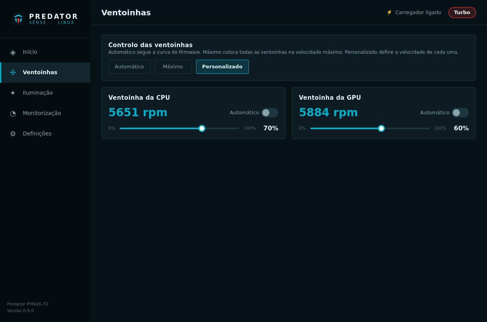
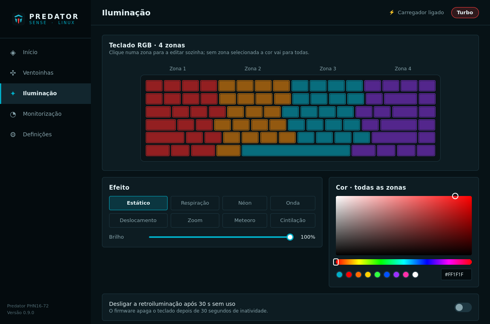
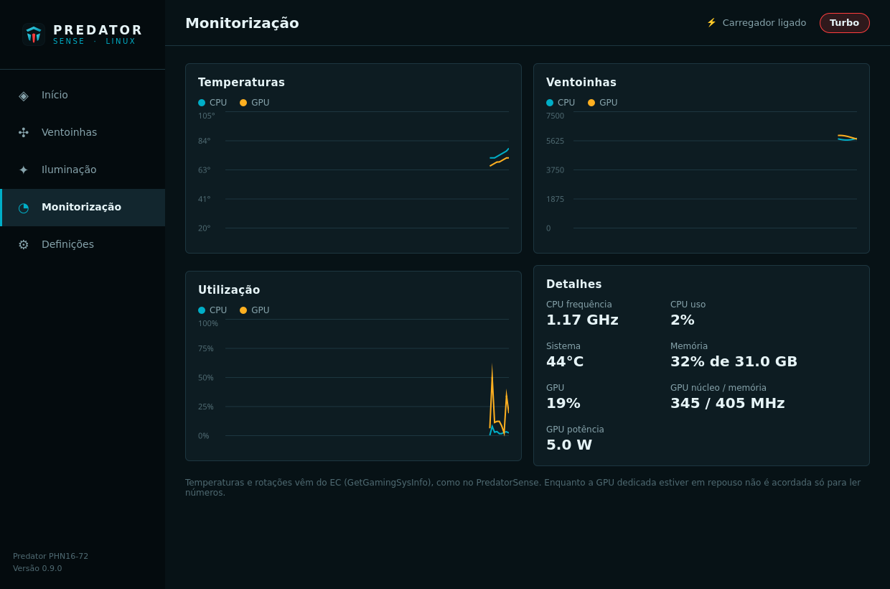
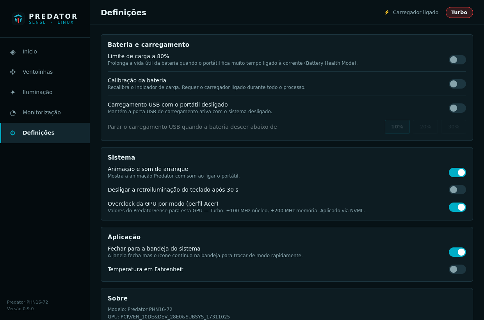

<div align="center">


# Predator Sense for Linux

**A native Linux re-implementation of Acer PredatorSense, built by reverse engineering the original Windows software.**
Performance modes · fan control · RGB keyboard · battery care — talking to the firmware exactly the way Acer's own service does.

[](https://github.com/aishend/predator-sense-phn16-72-linux/actions/workflows/ci.yml)
[](LICENSE)


[Português](README.pt.md)


</div>

> [!IMPORTANT]
> Unofficial project, not affiliated with or endorsed by Acer. "Predator" and "PredatorSense" are trademarks of Acer Inc.
> It changes firmware settings (fans, power limits, charging). It only uses the same firmware calls as Acer's software, but use it at your own risk.

## Why another one?

Existing Linux tools for Predator laptops re-implement *some* calls with hard-coded values from unofficial sources. This project started from the
other end: **PredatorSense 5.0.1463 was decompiled** (Ghidra) and every value sent to the firmware was traced back to
Acer's code — the UI (Electron), `AcerAgentService`, `AcerHardwareService`, `AcerLightingService` and the
QuickAccess/CareCenter agents. The result reproduces the original behaviour, including the details that are easy to get wrong:

- fans are grouped exactly like Acer does (auto/custom groups, per-fan IDs, fan count detected from the firmware);
- static keyboard colours first send the zone mask (`SetGamingLED`) sized by the SMBIOS 172 version, like AcerLightingService;
- the keyboard backlight timeout keeps the current brightness;
- power-off USB charging keeps its on/off switch independent from the 10/20/30 % threshold;
- on battery only *Balanced* or *Eco* are allowed, with a separate remembered mode for AC and DC;
- entering or leaving *Quiet* puts the fans back to *Auto*;
- *Turbo* applies Acer's GPU clock profile for your exact GPU (PHN16-72 + RTX 4060: +100 MHz core / +200 MHz memory).

Method IDs and parameter layouts come from the firmware itself: the WMI class definitions (BMOF) embedded in the
PHN16-72 BIOS. You can check them on your own machine with `sudo tools/bmof-verify.py`.

The full protocol, with the address of every finding, is in [docs/REVERSE_ENGINEERING.md](docs/REVERSE_ENGINEERING.md).

## Features

| Area | What you get |
|---|---|
| Operating modes | Quiet, Balanced, Performance, Turbo, Eco (the list is read from the firmware) · separate battery mode · Acer GPU overclock profile per mode (via NVML) |
| Fans | Auto, Max, Custom per fan (CPU / GPU, 0–100 %) with live RPM |
| RGB keyboard | 4-zone static colours, Breathing, Neon, Wave, Shifting, Zoom, Meteor, Twinkling · brightness, speed, direction · auto-off after 30 s |
| Battery | 80 % charge limit (Battery Health) · battery calibration · power-off USB charging with 10/20/30 % cut-off |
| System | Boot animation & sound · LCD overdrive (when the panel supports it) |
| Monitoring | CPU/GPU/system temperatures and fan RPM straight from the EC, CPU/RAM/GPU usage and clocks — never wakes a sleeping dGPU |
| Desktop | Tray icon with quick mode switch · works with the Predator mode key and with the desktop power-profile switch (through `acer_wmi`) · restores everything after suspend · `predatorctl` CLI |

<table>
<tr>
<td></td>
<td></td>
</tr>
<tr>
<td></td>
<td></td>
</tr>
</table>

## Supported hardware

| Model | Status |
|---|---|
| Acer Predator Helios Neo 16 **PHN16-72** | Primary target — validation on real hardware in progress |
| Other Predator / Nitro laptops with PredatorSense 5 (`AcerGamingFunction` WMI) | Likely to work: capabilities are detected from the firmware. Please open a *hardware report* issue |

Per-key USB RGB keyboards (some Helios 16/18) are not supported yet.

## Architecture

```
 predator-sense (Qt 6 / QML)          predatorctl (CLI)
          └──────────── system D-Bus + polkit ────────────┐
                                         predator-sensed (root service)
                                                          │ ioctl
                                       /dev/predator-wmi  (predator_wmi kernel module)
                                                          │ ACPI-WMI
                                                 laptop firmware / EC
```

| Component | Role (Windows equivalent) |
|---|---|
| `kernel/` `predator_wmi` | Tiny pass-through to the three Acer WMI interfaces with a fixed allow-list of methods — the Linux counterpart of the Windows WMI provider. No feature logic, no raw EC access. |
| `daemon/` `predator-sensed` | `AcerAgentService` + `AcerHardwareService` (+ parts of the lighting and QuickAccess agents). |
| `gui/` `predator-sense` | The PredatorSense UI. |
| `cli/` `predatorctl` | Scripting / terminal access. |

Hotkeys and the mode key stay with the in-kernel `acer_wmi` driver; the daemon follows its `platform_profile`
notifications, so the desktop power-profile switch (power-profiles-daemon) also drives the Predator modes.

## Installation

### Arch Linux / CachyOS

```bash
git clone https://github.com/aishend/predator-sense-phn16-72-linux.git
cd predator-sense-phn16-72-linux/packaging/arch
makepkg -si
```

This installs the kernel module through **DKMS** (rebuilt automatically for every new kernel, including clang-built
kernels such as CachyOS), the service (enabled and started), the app and the CLI. Make sure the headers of your
kernel are installed (`linux-cachyos-headers`, `linux-headers`, …).

The in-kernel `acer_wmi` driver handles the Predator mode key and hotkeys; make sure it is not blacklisted
(`grep -r acer_wmi /etc/modprobe.d/`).

### Other distributions (manual)

Requirements: CMake ≥ 3.21, Qt ≥ 6.5 (Base, Declarative, Svg, DBus), DKMS, kernel headers, polkit.

```bash
cmake -S . -B build -DCMAKE_BUILD_TYPE=Release -DCMAKE_INSTALL_PREFIX=/usr -DCMAKE_INSTALL_LIBEXECDIR=lib
cmake --build build
sudo cmake --install build
sudo cp -r kernel /usr/src/predator-wmi-0.9.0 && sudo dkms install predator-wmi/0.9.0
echo predator_wmi | sudo tee /etc/modules-load.d/predator-wmi.conf
sudo systemctl enable --now predator-sensed
```

## Usage

Open **Predator Sense** from the application menu, or use the CLI:

```bash
predatorctl status                     # current settings
predatorctl info                       # what the firmware supports
predatorctl sensors --watch
predatorctl mode turbo                 # quiet | balanced | performance | turbo | eco
predatorctl battery-mode eco           # mode used while unplugged
predatorctl fan custom 70 60           # CPU 70 %, GPU 60 %  (or: fan auto | fan max)
predatorctl kb static '#ff0000' '#ffb000' '#00aec7' '#8a2be2'
predatorctl kb wave --speed 6 --direction left
predatorctl set batteryLimit on        # also: batteryCalibration, usbCharging, usbChargingThreshold,
                                       #       bootSound, lcdOverdrive, kbTimeout, gpuOcInModes
```

Changing settings is allowed for the user of the active local session (polkit action
`org.predatorsense.control`); other users are asked for an administrator password.

## Safety design

- The kernel module only accepts an allow-list of method IDs on three Acer WMI GUIDs, and only from `CAP_SYS_ADMIN`.
- The service runs with systemd hardening, exposes high-level operations only, and validates every value
  (modes from the firmware capability list, fan speeds 0–100 %, effects/speeds/thresholds within Acer's ranges).
- Settings that live in the firmware (battery limit, USB charging, boot sound, …) are always read back from the
  hardware, never assumed.
- On first start nothing is changed: the service adopts the current firmware state.

## Development

You can work on the service and the UI without the hardware or root: `--simulate` runs the service against an
in-memory model of the firmware on the session bus.

```bash
cmake -S . -B build -G Ninja && cmake --build build
./build/predator-sensed --simulate &
PREDATOR_SENSE_BUS=session ./build/gui/predator-sense
PREDATOR_SENSE_BUS=session ./build/predatorctl status
```

See [CONTRIBUTING.md](CONTRIBUTING.md). Hardware reports from other models are very welcome.

## License

GPL-2.0-or-later — see [LICENSE](LICENSE). No Acer code or binaries are included; this project only documents and
re-implements the firmware interface for interoperability.
